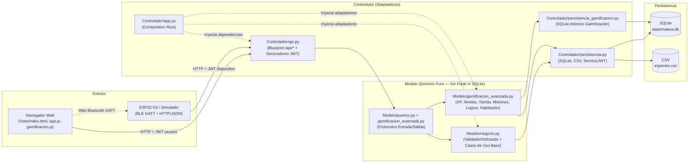
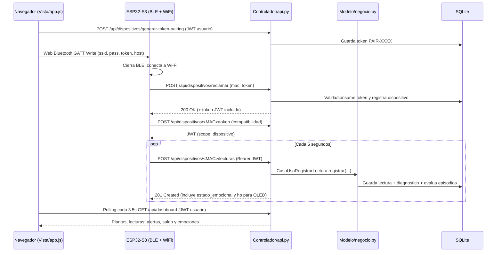
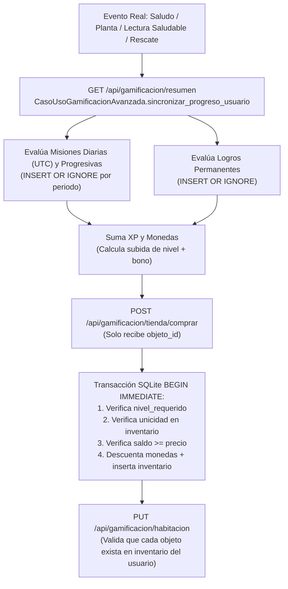

# Documento de Arquitectura de Software — Plantol

**Proyecto:** Plantol — Sistema Inteligente de Monitoreo IoT y Gamificación de Plantas  
**Arquitectura:** MVC + Arquitectura Hexagonal (Ports & Adapters) + SOLID  

---

## 1. Visión General del Sistema

Plantol separa estrictamente el **núcleo de dominio puro** (`Modelo/`) de los **adaptadores de infraestructura y control HTTP** (`Controlador/`) y de la **interfaz de usuario** (`Vista/`).  
Toda decisión agronómica (clasificación, `HP`, estado emocional) y económica (XP, niveles, misiones, logros, precios, compras y propiedad en habitación) reside exclusivamente en el backend dentro de `Modelo/`.

### Diagrama General y Hexagonal Real

---

## 2. Capas MVC y Responsabilidades

| Capa | Módulos reales | Responsabilidad | Restricción |
| :--- | :--- | :--- | :--- |
| **Modelo** | `Modelo/entidades.py`, `Modelo/puertos.py`, `Modelo/negocio.py`, `Modelo/gamificacion_avanzada.py` | Entidades inmutables/dominio, reglas agronómicas, cálculo de `HP`/emociones, progresión XP/niveles, catálogo oficial, misiones, logros y validación de habitación. | Cero imports de Flask, SQLite, HTTP, HTML o JS. |
| **Controlador** | `Controlador/app.py`, `Controlador/api.py`, `Controlador/persistencia.py`, `Controlador/persistencia_gamificacion.py` | Composition Root, validación de esquemas HTTP, autenticación JWT por `scope`, manejo de errores y adaptadores concretos SQLite/CSV. | No acumula reglas de negocio ni cálculos de recompensas. |
| **Vista** | `Vista/index.html`, `Vista/styles.css`, `Vista/app.js`, `Vista/gamificacion.js` | Presentación, traducción amigable de mensajes, detalles desplegables, diseño responsive, Web Bluetooth GATT y renderizado de tienda/habitación. | No decide precios, saldos, XP, niveles ni estados definitivos. |

---

## 3. Puertos, Casos de Uso y Adaptadores Reales

### Puertos de Entrada (`Modelo/puertos.py` y `Modelo/gamificacion_avanzada.py`)
- `RegistrarLecturaPort` → `CasoUsoRegistrarLectura`
- `ConsultarEstadoPort` → `CasoUsoConsultarEstado`
- `GestionPlantasPort` → `CasoUsoGestionPlantas`
- `AutenticacionPort` → `CasoUsoAutenticacion`
- `GamificacionPort` → `CasoUsoGamificacion`
- `CasoUsoGamificacionAvanzada` (orquesta progresión, misiones, logros, tienda, inventario y habitación)

### Puertos de Salida y Adaptadores Concretos
- `TablaReferenciaPort` → `TablaReferenciaCSV` (`especies.csv`) o `TablaReferenciaBD` (SQLite)
- `HistorialLecturasPort` → `HistorialLecturasBD` (`historial_lecturas` en SQLite)
- `RepositorioPlantasPort`, `RepositorioUsuariosPort`, `RepositorioDispositivosPort`, `RepositorioGamificacionPort` → `RepositorioSQLite` / `RepositorioGamificacionBD`
- `EmisorTokenPort` → `ServicioJWT` (PyJWT HS256)
- `RepositorioGamificacionAvanzadaPort` → `RepositorioGamificacionAvanzadaSQLite` (`Controlador/persistencia_gamificacion.py`)

---

## 4. Base de Datos SQLite (`data/matera.db`)

### Tablas principales y relaciones
- `usuarios (id PK, username UNIQUE, password_hash, nombre, email, rol)`
- `dispositivos (id PK, secret_hash, mac, planta_id, ultimo_contacto, estado_conexion)`
- `plantas (id PK, nombre, especie, usuario_id FK->usuarios, dispositivo_id UNIQUE FK->dispositivos, ubicacion, fecha_creacion)`
- `codigos_vinculacion (codigo PK, dispositivo_id, fecha_creacion, usado)` *(usado tanto para códigos como para tokens de pairing BLE `PAIR-...`)*
- `historial_lecturas (id PK, dispositivo_id, planta_id, timestamp, luminosidad, humedad, temperatura, humedad_suelo, estado_global, diagnostico_json, fecha_creacion)`
- `especies_referencia (nombre PK, lux_min, lux_max, humedad_min, humedad_max, temperatura_min, temperatura_max)`
- **Gamificación base:** `gamificacion_puntos`, `gamificacion_transacciones`, `gamificacion_saludos`, `gamificacion_episodios`
- **Gamificación avanzada:** `gamificacion_progresion`, `gamificacion_misiones`, `gamificacion_logros`, `gamificacion_inventario`, `gamificacion_habitacion`

Las inicializaciones ejecutan migraciones seguras no destructivas (`_asegurar_columna` mediante `PRAGMA table_info`).

---

## 5. Flujos Principales Implementados

### 5.1. Flujo ESP32 → Backend → Frontend

### 5.2. Flujo de Gamificación Avanzada, Compra Atómica y Habitación

---

## 6. Seguridad, Decisiones Arquitectónicas y Riesgos Pendientes

### Medidas implementadas
- **Aislamiento de recursos:** todas las consultas de plantas, historial, saludos, puntos, compras, inventario y habitación se filtran por `usuario_id` extraído del JWT verificado.
- **Integridad de compras:** el backend consulta `MAPA_CATALOGO` y ejecuta la compra en transacción `BEGIN IMMEDIATE`, impidiendo manipulación de precios/saldos desde frontend, compras concurrentes duplicadas o saldos negativos.
- **Prevención XSS:** `Vista/app.js` y `Vista/gamificacion.js` escapan todo dato dinámico (`escapeHtml`) y usan delegación de eventos (`data-action`) en lugar de `onclick` con cadenas interpoladas.
- **Modo demo seguro:** deshabilitado por defecto; requiere `PLANTOL_DEMO=1` en servidor (`POST /api/auth/demo`) sin credenciales hardcodeadas en `Vista/`.

### Riesgo pendiente documentado (sin modificar firmware)
- **`POST /api/dispositivos/<dispositivo_id>/token` sin autenticación propia:** actualmente se eliminó `GET`, pero `POST` se mantiene accesible para dispositivos ya registrados porque el firmware flasheado en la ESP32-S3 invoca esa ruta sin secreto tras `/reclamar`.
- **Plan de resolución futuro (requiere cambio coordinado en firmware):** actualizar el firmware de `Planta_Inteligente` para consumir directamente el JWT devuelto por `POST /api/dispositivos/reclamar` (campo `"token"` ya implementado en backend) y exigir secreto de dispositivo o deshabilitar el endpoint público `/token`.

### Limitaciones actuales conocidas
- La clave JWT por defecto solo debe usarse en desarrollo local; en producción es obligatorio configurar `JWT_SECRET_KEY`.
- La verificación visual en navegador real para las resoluciones responsive (`1920`, `1366`, `768`, `430`, `390`, `360 px`) queda sujeta a ejecución manual en Chrome/Edge al no estar disponible el puerto de depuración remota en el entorno de pruebas.
